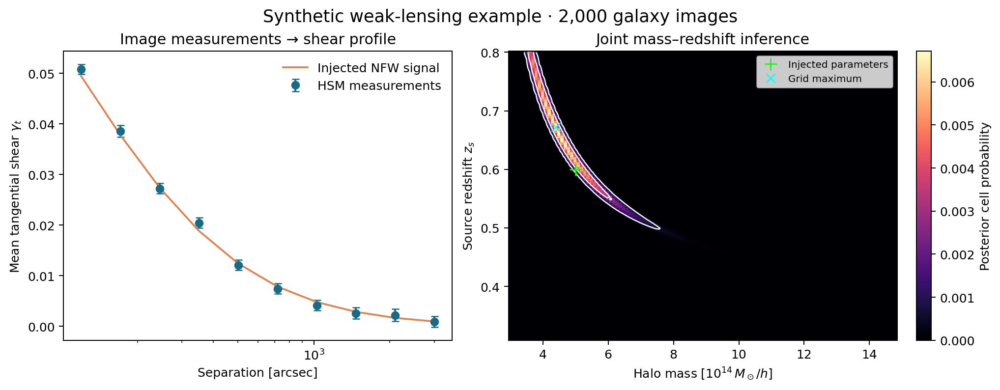
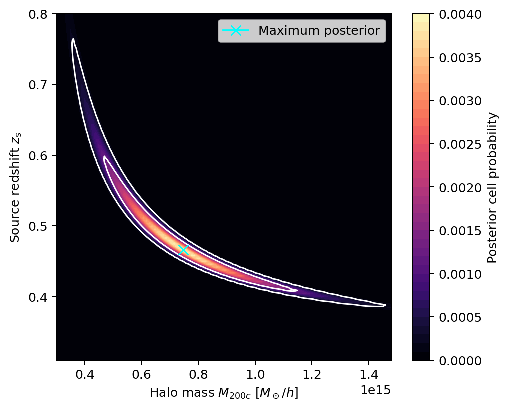

# Weak Lensing and Halo-Mass Inference

Galaxy shape measurement, stacked tangential shear profiles and Bayesian inference of dark-matter halo mass from simulated galaxy images.

The analysis compares unweighted moments, Gaussian-weighted moments and GalSim adaptive moments, then uses the stacked HSM profile to infer NFW halo mass and source redshift. It illustrates how image measurements propagate into a physical inference and how uncertainty in source distance creates a mass–redshift degeneracy.

## Features

- Three galaxy-shape estimators, with failed measurements retained in catalogue order.
- Tangential stacking around multiple halos, logarithmic radial bins and shape-noise error estimates.
- Joint mass–redshift inference and a mass posterior at fixed source redshift.
- A reproducible synthetic example that generates its own galaxy images.
- Batched FITS processing, command-line workflows and two executable notebooks.

## Installation

Python **3.11+** is required. From the repository root:

```bash
python -m venv .venv
source .venv/bin/activate
python -m pip install -r requirements.txt
python -m pip install --no-deps --no-build-isolation -e .
```

## Quick start

```bash
python -m weak_lensing.demo --output-dir outputs/synthetic --seed 625
```

This generates 2,000 noisy Gaussian galaxy images around one halo and runs shape measurement, profile stacking and parameter inference. It needs no external dataset. See [Running the analysis](RUNNING.md) for the external-data workflow and notebooks.



*Synthetic example with seed 625, an injected mass of $5\times10^{14}\,M_\odot/h$ and source redshift 0.6. The images have circular intrinsic profiles and additive pixel noise. The example omits PSF convolution, intrinsic shape dispersion, convergence and blending; it is a controlled illustration of the workflow.*

## Simulation analysis

The supplied dataset contains **100,000 simulated galaxy stamps and 100 halo positions**. Shapes are stacked in ten logarithmic bins from 100 to 3,600 arcsec. The inference fixes halo concentration to 4, halo redshift to 0.3 and the cosmology to $\Omega_m=0.3$, $\Omega_\Lambda=0.7$.

| Inference | Grid maximum |
| --- | --- |
| Joint halo mass and source redshift | $M_{200c}=7.462\times10^{14}\,M_\odot/h$, $z_s=0.466$ |
| Halo mass at fixed $z_s=0.6$ | $M_{200c}=4.686\times10^{14}\,M_\odot/h$ |

The complete-data analysis uses a 120 × 120 grid; [run settings and summary](assets/coursework_summary.json) accompany the figure below. They are grid maxima under the specified model, rather than measurements of an observed survey. The input data are supplied separately and are not distributed here, in accordance with their usage conditions. [Data format and outputs](docs/data.md) describes how to use a local copy.



*Complete simulated dataset, HSM profile, 120 × 120 grid. White contours show the 68% and 95% credible thresholds; the cyan marker identifies the grid maximum.*

## Method and interpretation

The HSM components are observed image-shape parameters used as weak-shear proxies. The analysis does not apply PSF correction or shear-response calibration. The two direct moment estimators use the definition $e_2=Q_{xy}/D$, where $D=Q_{xx}+Q_{yy}+2\sqrt{Q_{xx}Q_{yy}-Q_{xy}^2}$; this differs from the conventional reduced-shear second component by a factor of two.

The likelihood uses per-bin standard errors and a diagonal covariance approximation. Repeated sources across halos and correlations between bins are not modelled. See [Method and interpretation](docs/method.md) for the estimator definitions, posterior normalisation and limits of the inference.

## Notebooks

| Notebook | Contents |
| --- | --- |
| [Synthetic walkthrough](notebooks/01_synthetic_walkthrough.ipynb) | Generate images, compare shape estimators, stack a profile and recover a mass posterior. |
| [Simulation analysis](notebooks/02_simulation_analysis.ipynb) | Analyse external simulated inputs or inspect saved numerical results. |

## Repository structure

```text
src/weak_lensing/  Shape estimators, inference, plotting and synthetic images
scripts/           Image-analysis command-line entry point
notebooks/         Synthetic and external-data workflows
assets/            Synthetic example figures
docs/              Method, data schema and references
tests/             Numerical and workflow checks
```

## Development

```bash
python -m pip install -r requirements-dev.txt
python -m pytest -q
```

Scientific, software and teaching sources are listed in [References](docs/references.md).
